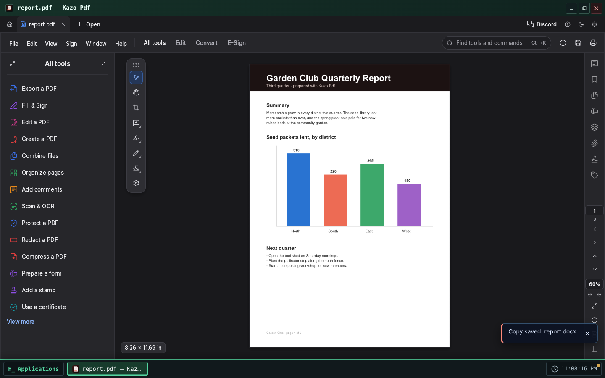
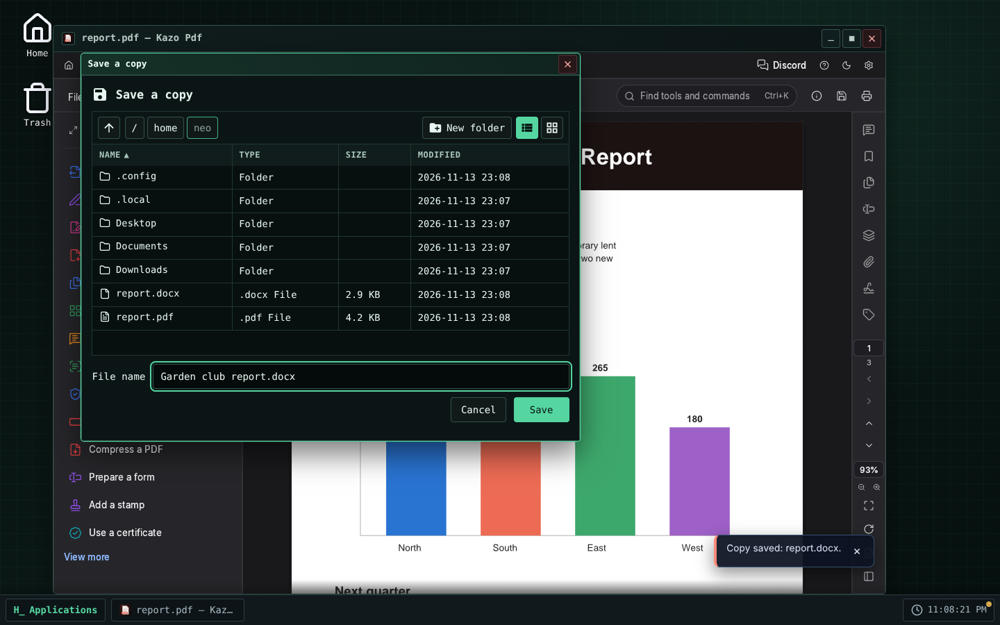
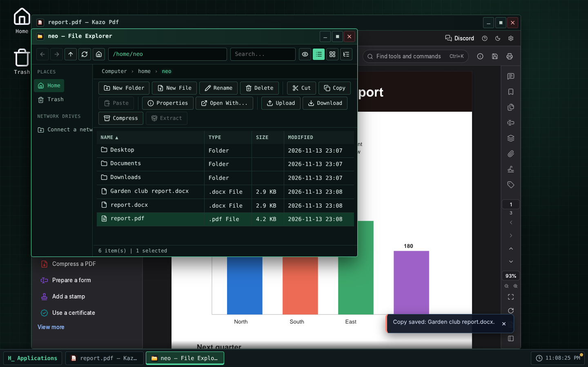

> [Version française](readme-fr.md)

<!-- Store listing: generated from store/ by .github/scripts/store-readme.mjs. Edit store/, then run it. -->


# Kazo Pdf

A PDF reader and editor for Kazo OS. Kazo Pdf is based on
[PdfCraft](https://github.com/storytold/pdfcraft) by the ArtCraft team, an open-source PDF editor
written in Rust, which runs here in a Kazo OS window.

## Read and edit

- Read, search, zoom, and browse pages, bookmarks and thumbnails.
- Annotate: highlight, comment, draw, stamps, measurements.
- Edit text and images; reorder, rotate, insert, extract and delete pages; combine several files.
- Fill in and create forms, sign, protect with a password, redact.
- Recognize the text of a scanned document (OCR): the models ship with the app, nothing goes to the
  Internet.
- Several windows at once, each with its own documents.

## Your Kazo OS files

- Double-click a `.pdf` file in the File Explorer: it opens in Kazo Pdf.
- Save rewrites the open PDF. Save As (Ctrl+Shift+S) and the first save of a new document go
  through the Kazo OS save dialog.
- Exports (Word, images, text, Print to PDF, Reduce size, signed copy, form data, OCR result…) go
  through the Kazo OS "Save a copy" dialog: the document stays bound to its file.
- Closing the window asks before losing changes, for each open document.
- File › Open, and the images, fonts and digital IDs to insert, come from the Kazo OS files,
  through the Kazo OS dialog.
- Kazo Pdf follows the OS theme (light or dark) and language; its settings are kept per Kazo OS
  user in `~/.config/ca.kazo.pdf/`.

## Known limits

- **PdfCraft is in alpha.** Most documents open and save fine, but keep a copy of the important
  ones.
- **Asian scripts**: the web version of PdfCraft has no Chinese, Japanese or Korean font; that text
  may show as boxes in the interface, and writing Japanese into a PDF returns an error.
- PdfCraft draws with **WebGL 2**: a browser or computer without WebGL 2 shows an error screen
  instead of the document.
- The download is about 34 MB (77 MB once installed), and each window loads its own copy of
  PdfCraft. Text recognition needs a lot of memory (about 600 MB per task).
- The window stays on the screen it opened on: moving it to another screen would reload PdfCraft
  and lose the open documents.
- Requires Kazo OS 3.3.4 or later.

## License

Kazo Pdf is free software under the MIT license. PdfCraft is under the MIT or Apache-2.0 license;
its notices, the licenses of the fonts it contains and the license of the text recognition models
(CC-BY-SA-4.0, Robert Knight) ship with the app (see `THIRD-PARTY-NOTICES.md` in the repository).
The ArtCraft name and logos are trademarks of the ArtCraft team and are not used by Kazo Pdf.

## Screenshots

<p>
  
  
  
</p>

<!-- /Store listing -->

## Try it

[Open Kazo Pdf in Kazo OS](https://os.kazo.ca/?autolaunch=ca.kazo.pdf): the link starts Kazo OS, installs the app from the official Store and opens it.

Or open [Kazo OS](https://os.kazo.ca/) and install Kazo Pdf from the **Kazo OS Store** (category Productivity), or in the Kazo OS Terminal, as an administrator: `sudo kazopkg install Kazo-ca/Os-App-PDF`.

## About Kazo OS

[Kazo OS](https://github.com/Kazo-ca/Os) is a simulated operating system that runs in the browser, written in C# with Blazor WebAssembly. It gives a complete environment to build and run applications: desktop and windows, a persistent file system, processes, a POSIX shell, a simulated network, the Kazo OS Store, and a public SDK (NuGet packages) to make apps such as this one. Try it at <https://os.kazo.ca/> (PWA, works offline).

## Development

- Plan: [plan](doc/en/plan.md). PdfCraft's notices and the licenses in the package: [THIRD-PARTY-NOTICES.md](THIRD-PARTY-NOTICES.md).

| Folder | Content |
| --- | --- |
| `src/Kazo.Pdf` | The app (window app, its `[AppManifest]` class generates `manifest.json`) |
| `src/Kazo.Pdf.Os` | A host that runs the whole Kazo OS with the base apps and this app: the project to start |
| `tests/Kazo.Pdf.Tests` | Tests of the app (xUnit) |
| `tests/e2e` | End-to-end runs in the Kazo OS host (Playwright): `npm run test:e2e` after `dotnet build Kazo.Pdf.slnx -c Debug` |
| `external/KazoOs` | The Kazo OS repository as a git submodule, on a release tag |
| `external/pdfcraft` | PdfCraft's sources (our fork `Kazo-ca/pdfcraft`) as a git submodule, only to compile PdfCraft (`tools/build-pdfcraft.sh`, workflow Build PdfCraft) |
| `src/Kazo.Pdf/wwwroot/pdfcraft` | The PdfCraft web build and its provenance `pdfcraft.json`, written by `tools/build-pdfcraft.sh` (or `tools/vendor-pdfcraft.sh` from the official zip), never edited by hand |
| `store/` | What the Kazo OS Store shows: icon (PNG 256×256), short descriptions, descriptions, screenshots, `store.json` |
| `tests/installed` | The app as the Store installs it, in a published Kazo OS: `kazopkg install`, a PDF opened by double-click, the Store screenshots (`npm run test:installed`) |
| `THIRD-PARTY-NOTICES.md` | PdfCraft and what it bundles; linked into the package with `LICENSE` (`wwwroot/legal/`, with the license files PdfCraft's NOTICE refers to in `wwwroot/legal/pdfcraft/`) |

### First steps

```bash
# A repository created from the GitHub template already has the submodule:
git clone --recurse-submodules <your repository>

# A folder made with "dotnet new kazoos-solution" adds it once:
git init
git submodule add --depth 1 https://github.com/Kazo-ca/Os.git external/KazoOs
git -C external/KazoOs checkout v<Kazo OS version>
```

Then open `Kazo.Pdf.slnx` in Visual Studio or Rider and start `Kazo.Pdf.Os`, or run
`dotnet run --project src/Kazo.Pdf.Os`.

### The Kazo OS version

`external/KazoOs/wasm2/KazoOs/build/Versions.props` is the Kazo OS version of this repository.
To move to another version, move the submodule to its tag and commit it:

```bash
git -C external/KazoOs fetch --depth 1 origin tag v2.2.0
git -C external/KazoOs checkout v2.2.0
git add external/KazoOs
```

Never edit the submodule: the OS is not modified from an app repository, and CI refuses a
submodule with local changes or off its tag.

### Two build profiles

| Profile | Kazo OS comes from | Use |
| --- | --- | --- |
| `Debug` | the projects of the submodule (`KazoOsUseSource=true`) | step into the SDK and the OS, breakpoints anywhere |
| `Release` | the `Kazo.Os.*` packages of nuget.org, at the submodule's version | CI, `dotnet publish`, the Kazo OS Store |

Force either one with `-p:KazoOsUseSource=true` or `false`.

### Publishing to the Kazo OS Store

1. Fill `store/` (icon, short descriptions, descriptions, screenshots, category and tags in
   `store.json`), then run `npm run store:readme`: it copies the descriptions and screenshots to the
   top of `README.md` and `readme-fr.md`, so the repository shows the same listing as the Store. CI
   fails when a README differs from `store/`.
2. Change `Version` in `PdfApp` (the `[AppManifest]` class) and commit it to `main` (or run
   `bash .github/scripts/bump-app-version.sh src/Kazo.Pdf patch`, which also updates the committed
   `manifest.json`), then tag it: run the **Tag a release** workflow (Actions tab, or the GitHub API
   for an agent), which tags the head of `main` (or of `beta` for a beta version) with the manifest's
   version and starts the two publishing workflows; or push the tag yourself:
   `git tag v0.1.1 && git push --tags`.
3. The **Publish to the Kazo OS Store** workflow builds the app and makes the catalog folder
   `apps/ca.kazo.pdf_<version>/`, then opens the pull request to `Kazo-ca/Os-AppMarketPlace`: to its
   `main` branch for a stable version, to its `beta` branch for a version with a suffix
   (`0.1.1-beta.1`). It uses the Kazo OS automation GitHub App (organization secrets
   `KAZO_AUTOMATION_APP_ID` and `KAZO_AUTOMATION_APP_KEY`, branch `submit/ca.kazo.pdf_<version>` of
   the catalog, no fork), otherwise a `HACK_STORE_TOKEN` secret (from the token owner's fork);
   without either, download the run's artifact and open the pull request yourself.

`HACK_STORE_TOKEN` is a GitHub personal access token of yours, not something Kazo OS gives you:

1. GitHub ▸ **Settings** ▸ **Developer settings** ▸ **Personal access tokens** ▸ **Tokens (classic)** ▸
   **Generate new token (classic)**, with a short expiration and the **`repo`** and **`workflow`**
   scopes (a fine-grained token cannot cover both your fork and the catalog's repository).
2. Copy it (shown once) into this repository: **Settings** ▸ **Secrets and variables** ▸ **Actions** ▸
   **New repository secret**, name `HACK_STORE_TOKEN` (or `gh secret set HACK_STORE_TOKEN`).

`repo` reaches all your repositories: keep the token only in this secret and revoke it if in doubt.

The catalog never takes a binary from you: once your pull request is reviewed and merged, its CI
compiles the app at the tagged commit. Nothing is signed in this repository.

### Following new Kazo OS versions

The **Kazo OS SDK update** workflow (`sdk-update.yml`) runs every hour, when Kazo OS announces a
release (`repository_dispatch` `kazoos-sdk-released`), or by hand from the Actions tab. When Kazo OS
has a newer version, it moves the submodule to it, raises the app's version
(`.github/scripts/bump-app-version.sh`) on a `kazoos-sdk/<version>` branch and runs the CI there:

- a Kazo OS pre-release: the `beta` branch takes it, as version `x.y.(z+1)-beta.<n>`, which goes to
  the beta channel of the Kazo OS Store;
- a minor or major stable release: a pull request to `main`, merged, tagged and published;
- a patch stable release: checked only, nothing is published.

A red CI opens a `TODO` issue and changes nothing. It only moves the Kazo OS submodule and the
app's version: the PdfCraft build in `src/Kazo.Pdf/wwwroot/pdfcraft/` changes only through
**Build PdfCraft**. The workflows of this repository are short: they call the shared workflows of
[Kazo-ca/Os-AppTemplate](https://github.com/Kazo-ca/Os-AppTemplate) (`@v1`), so they improve
without a change here; **Build PdfCraft** (`build-pdfcraft.yml`) is the only one of its own.

### Publishing on the `kazoos-packages` branch

The same `v*` tag also runs **Publish the Kazo OS packages**: it packs the app and pushes it to the
`kazoos-packages` branch of this repository, keeping the versions already published. Kazo OS
users then install it with `kazopkg install Kazo-ca/Os-App-Pdf`, without the Kazo OS Store.

These packages are not signed: apps are signed only in the Kazo OS Store repository
(`Kazo-ca/Os-AppMarketPlace`), when it builds your app from the catalog (ADR 0219). Kazo OS checks
them by their SHA-256 and asks an administrator before installing from an untrusted source. Users
who want a signed package install your app from the Kazo OS Store.
