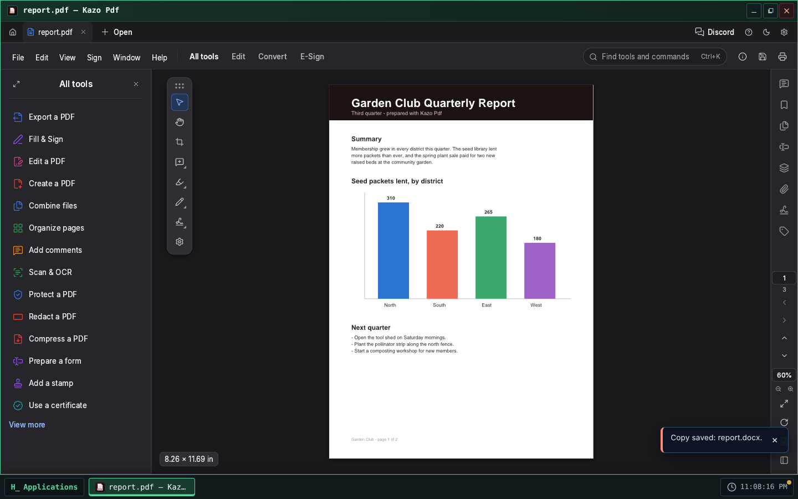
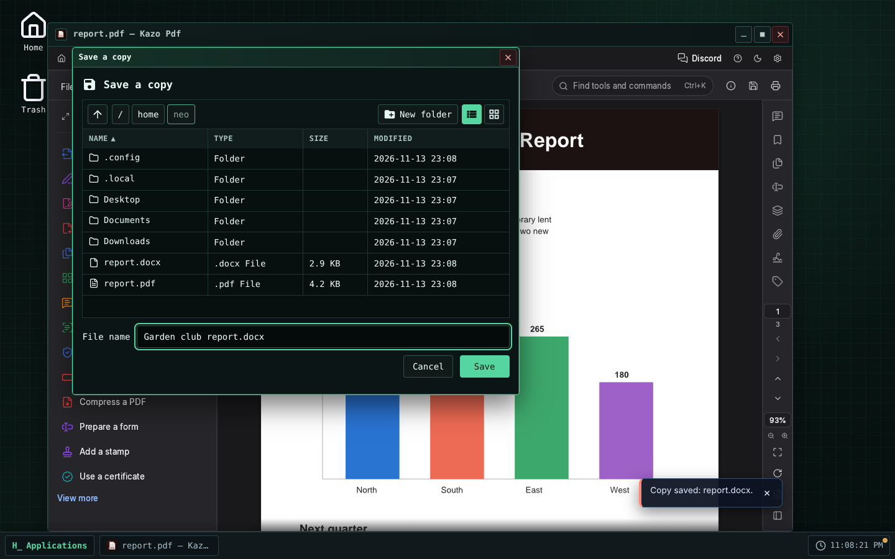
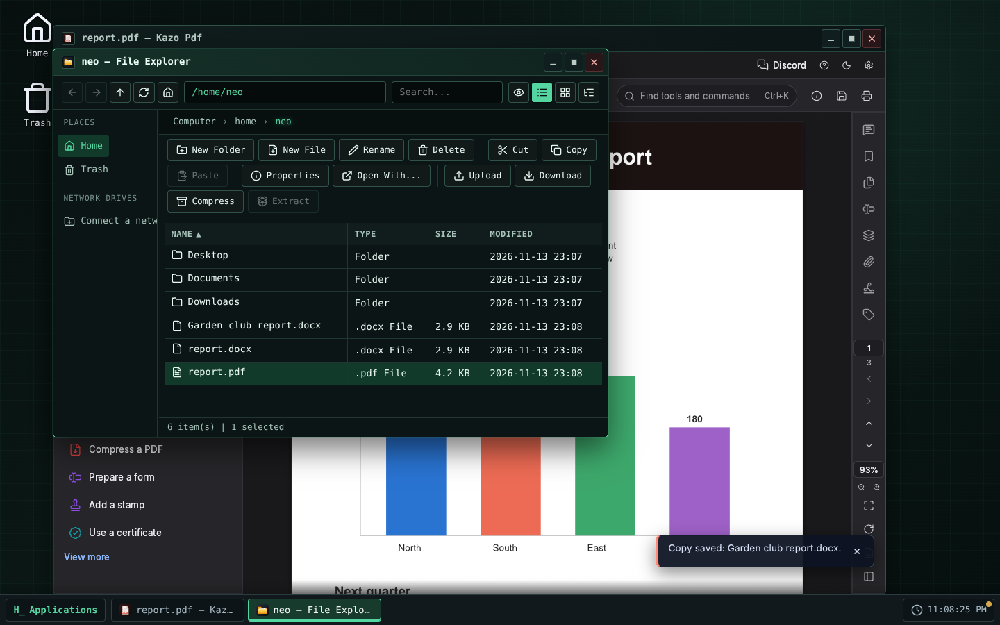

> [English version](README.md)

<!-- Fiche du Store : générée depuis store/ par .github/scripts/store-readme.mjs. Modifiez store/, puis lancez-le. -->


# Kazo Pdf

Un lecteur et éditeur de PDF pour Kazo OS. Kazo Pdf est basé sur
[PdfCraft](https://github.com/storytold/pdfcraft) de l'équipe ArtCraft, un éditeur PDF libre écrit
en Rust, qui tourne ici dans une fenêtre de Kazo OS.

## Lire et modifier

- Lire, chercher, zoomer, parcourir les pages, les signets et les vignettes.
- Annoter : surligner, commenter, dessiner, tampons, mesures.
- Modifier le texte et les images, réorganiser, faire pivoter, insérer, extraire et supprimer des
  pages, combiner plusieurs fichiers.
- Remplir et créer des formulaires, signer, protéger par mot de passe, caviarder.
- Reconnaître le texte d'un document numérisé (OCR) : les modèles sont livrés avec l'app, rien ne
  part sur Internet.
- Plusieurs fenêtres à la fois, chacune avec ses documents.

## Vos fichiers Kazo OS

- Double-cliquez sur un fichier `.pdf` dans l'Explorateur de fichiers : il s'ouvre dans Kazo Pdf.
- Enregistrer réécrit le PDF ouvert. Enregistrer sous (Ctrl+Maj+S) et le premier
  enregistrement d'un nouveau document passent par le dialogue d'enregistrement de Kazo OS.
- Les exports (Word, images, texte, Imprimer en PDF, Réduire la taille, copie signée, données de
  formulaire, résultat de l'OCR…) passent par le dialogue « Enregistrer une copie » de Kazo OS :
  le document reste lié à son fichier.
- Fermer la fenêtre demande avant de perdre des modifications, pour chaque document ouvert.
- Fichier › Ouvrir, les images, les polices et les identités numériques à insérer viennent des
  fichiers Kazo OS, par le dialogue de Kazo OS.
- Kazo Pdf suit le thème (clair ou sombre) et la langue de l'OS ; ses réglages sont gardés par
  utilisateur Kazo OS dans `~/.config/ca.kazo.pdf/`.

## Limites connues

- **PdfCraft est en alpha.** La plupart des documents s'ouvrent et s'enregistrent bien, mais gardez
  une copie des plus importants.
- **Écritures asiatiques** : la version web de PdfCraft n'a pas de police chinoise, japonaise ou
  coréenne ; ce texte peut s'afficher en carrés dans l'interface, et y écrire du japonais dans un
  PDF renvoie une erreur.
- PdfCraft dessine avec **WebGL 2** : un navigateur ou un ordinateur sans WebGL 2 montre un écran
  d'erreur au lieu du document.
- Le téléchargement fait environ 34 Mo (77 Mo une fois installé), et chaque fenêtre charge sa
  propre copie de PdfCraft. La reconnaissance de texte demande beaucoup de mémoire (environ 600 Mo
  par tâche).
- La fenêtre reste sur l'écran où elle s'est ouverte : la passer sur un autre écran rechargerait
  PdfCraft et perdrait les documents ouverts.
- Demande Kazo OS 3.3.4 ou plus récent.

## Licence

Kazo Pdf est un logiciel libre sous licence MIT. PdfCraft est sous licence MIT ou Apache-2.0 ; ses
avis, les licences des polices qu'il contient et celle des modèles de reconnaissance de texte
(CC-BY-SA-4.0, Robert Knight) sont livrés avec l'app (voir `THIRD-PARTY-NOTICES-fr.md` dans le
dépôt). Le nom et les logos ArtCraft sont des marques de l'équipe ArtCraft et ne sont pas utilisés
par Kazo Pdf.

## Captures d'écran

<p>
  
  
  
</p>

<!-- /Fiche du Store -->

## Essayer

[Ouvrir Kazo Pdf dans Kazo OS](https://os.kazo.ca/?autolaunch=ca.kazo.pdf) : le lien démarre Kazo OS, installe l'app depuis le Store officiel et l'ouvre.

Ou ouvrez [Kazo OS](https://os.kazo.ca/) et installez Kazo Pdf depuis le **Kazo OS Store** (catégorie Productivité), ou dans le Terminal de Kazo OS, en administrateur : `sudo kazopkg install Kazo-ca/Os-App-PDF`.

## À propos de Kazo OS

[Kazo OS](https://github.com/Kazo-ca/Os) est un système d'exploitation simulé qui tourne dans le navigateur, écrit en C# avec Blazor WebAssembly. Il offre un environnement complet pour développer et exécuter des applications : bureau et fenêtres, système de fichiers persistant, processus, shell POSIX, réseau simulé, le Kazo OS Store, et un SDK public (paquets NuGet) pour créer des apps comme celle-ci. Essayez-le sur <https://os.kazo.ca/> (PWA, fonctionne hors ligne).

## Développement

- Plan : [plan](doc/fr/plan.md). Les avis de PdfCraft et les licences du paquet : [THIRD-PARTY-NOTICES-fr.md](THIRD-PARTY-NOTICES-fr.md).

| Dossier | Contenu |
| --- | --- |
| `src/Kazo.Pdf` | L'app (app fenêtrée ; sa classe `[AppManifest]` génère `manifest.json`) |
| `src/Kazo.Pdf.Os` | Un hôte qui lance tout Kazo OS avec les apps de base et cette app : le projet à démarrer |
| `tests/Kazo.Pdf.Tests` | Les tests de l'app (xUnit) |
| `tests/e2e` | Les parcours de bout en bout dans l'hôte Kazo OS (Playwright) : `npm run test:e2e` après `dotnet build Kazo.Pdf.slnx -c Debug` |
| `external/KazoOs` | Le dépôt Kazo OS en sous-module git, sur un tag de release |
| `external/pdfcraft` | Les sources de PdfCraft (notre fork `Kazo-ca/pdfcraft`) en sous-module git, seulement pour compiler PdfCraft (`tools/build-pdfcraft.sh`, workflow Build PdfCraft) |
| `src/Kazo.Pdf/wwwroot/pdfcraft` | Le build web de PdfCraft et sa provenance `pdfcraft.json`, écrits par `tools/build-pdfcraft.sh` (ou `tools/vendor-pdfcraft.sh` depuis le zip officiel), jamais modifiés à la main |
| `store/` | Ce que montre le Kazo OS Store : icône (PNG 256×256), descriptions courtes, descriptions, captures, `store.json` |
| `tests/installed` | L'app telle que le Store l'installe, dans un Kazo OS publié : `kazopkg install`, un PDF ouvert par double-clic, les captures du Store (`npm run test:installed`) |
| `THIRD-PARTY-NOTICES-fr.md` | PdfCraft et ce qu'il embarque ; lié dans le paquet avec `LICENSE` (`wwwroot/legal/`, avec les fichiers de licence que cite le NOTICE de PdfCraft dans `wwwroot/legal/pdfcraft/`) |

### Premiers pas

```bash
# Un dépôt créé depuis le template GitHub a déjà le sous-module :
git clone --recurse-submodules <votre dépôt>

# Un dossier créé par « dotnet new kazoos-solution » l'ajoute une fois :
git init
git submodule add --depth 1 https://github.com/Kazo-ca/Os.git external/KazoOs
git -C external/KazoOs checkout v<version de Kazo OS>
```

Ouvrez ensuite le `Kazo.Pdf.slnx` dans Visual Studio ou Rider et démarrez `Kazo.Pdf.Os`,
ou lancez `dotnet run --project src/Kazo.Pdf.Os`.

### La version de Kazo OS

`external/KazoOs/wasm2/KazoOs/build/Versions.props` est la version de Kazo OS de ce dépôt.
Pour changer de version, placez le sous-module sur son tag et validez-le :

```bash
git -C external/KazoOs fetch --depth 1 origin tag v2.2.0
git -C external/KazoOs checkout v2.2.0
git add external/KazoOs
```

Ne modifiez jamais le sous-module : on ne modifie pas l'OS depuis un dépôt d'app, et la CI refuse
un sous-module modifié ou hors de son tag.

### Deux profils de build

| Profil | Kazo OS vient de | Usage |
| --- | --- | --- |
| `Debug` | les projets du sous-module (`KazoOsUseSource=true`) | entrer dans le SDK et l'OS, points d'arrêt partout |
| `Release` | les paquets `Kazo.Os.*` de nuget.org, à la version du sous-module | CI, `dotnet publish`, le Kazo OS Store |

Forcez l'un ou l'autre avec `-p:KazoOsUseSource=true` ou `false`.

### Publier dans le Kazo OS Store

1. Remplissez `store/` (icône, descriptions courtes, descriptions, catégorie et étiquettes dans `store.json`).
2. Changez `Version` dans la classe `[AppManifest]` de l'app et validez-la dans `main`, puis posez le
   tag : lancez le workflow **Tag a release** (onglet Actions, ou l'API GitHub pour un agent), qui pose
   sur la tête de `main` le tag de la version du manifeste et lance les deux workflows de
   publication ; ou poussez le tag vous-même : `git tag v1.0.0 && git push --tags`.
3. Le workflow **Publish to the Kazo OS Store** compile l'app et produit le dossier du catalogue
   `apps/<appId>_<version>/`. Avec un secret `HACK_STORE_TOKEN` (un jeton qui peut créer un fork et
   ouvrir des pull requests), il ouvre la pull request vers `Kazo-ca/Os-AppMarketPlace` depuis
   votre fork ; sans lui, téléchargez l'artefact du workflow et ouvrez la pull request vous-même.

`HACK_STORE_TOKEN` est un jeton d'accès personnel GitHub à vous, que Kazo OS ne fournit pas :

1. GitHub ▸ **Settings** ▸ **Developer settings** ▸ **Personal access tokens** ▸ **Tokens (classic)** ▸
   **Generate new token (classic)**, avec une expiration courte et les scopes **`repo`** et
   **`workflow`** (un jeton à grain fin ne peut pas couvrir à la fois votre fork et le dépôt du catalogue).
2. Copiez-le (affiché une seule fois) dans ce dépôt : **Settings** ▸ **Secrets and variables** ▸
   **Actions** ▸ **New repository secret**, nom `HACK_STORE_TOKEN` (ou `gh secret set HACK_STORE_TOKEN`).

`repo` donne accès à tous vos dépôts : gardez le jeton dans ce seul secret et révoquez-le au moindre doute.

Le catalogue ne prend jamais de binaire de votre part : une fois votre pull request relue et
fusionnée, sa CI compile l'app au commit du tag.

### Publier sur la branche `kazoos-packages`

Le même tag `v*` lance aussi **Publish the Kazo OS packages** : il fait le paquet de l'app et le
pousse sur la branche `kazoos-packages` de ce dépôt, en gardant les versions déjà publiées. Les
utilisateurs de Kazo OS l'installent alors avec `kazopkg install <owner>/<repo>`, sans le Kazo OS Store.

Ces paquets ne sont pas signés : les apps sont signées seulement dans le dépôt du Kazo OS Store
(`Kazo-ca/Os-AppMarketPlace`), quand il compile votre app depuis le catalogue (ADR 0219). Kazo OS
les vérifie par leur SHA-256 et demande un administrateur avant d'installer depuis une source non
fiable. Pour un paquet signé, installez l'app depuis le Kazo OS Store.
